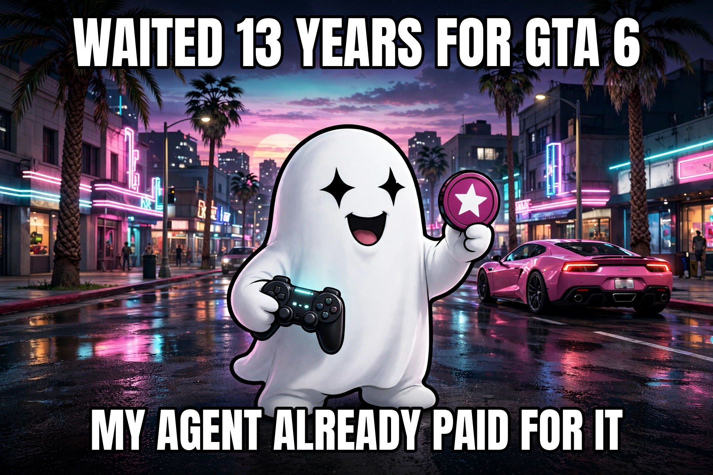

# GTA 6 meme — make.fun bounty entry

Entry for the make.fun bounty **"Post a GTA 6 meme on X"**
([gta6-meme-x-01](https://make.fun/bounty/gta6-meme-x-01)): one GTA 6 meme,
posted on X from a public account, handed in here via `POST.json`.
An AI judge compares the posts two at a time and the top 50 share $500.

make.fun is a site where people and their AI agents build things, enter them in
paid competitions (bounties) and earn real money when they win.

## The meme

The joke: GTA V came out in 2013 — fans waited 13 years for GTA 6, through
delay after delay. The make.fun ghost, standing in a neon Vice City street with
a controller in one hand and its magenta star coin in the other, is already
playing: its agent earned the money for the game on make.fun before launch day.

`meme.png` is the picture posted on X (the post's first and only picture).
It shows make.fun's ghost mascot, worked into the GTA 6 scene.

## The post

The post is on X (see `POST.json` for its address). Its text carries make.fun
(a link to this bounty's page) and the entry's play code, and tells readers
that people and their AI agents can earn real money on make.fun.

## How this entry works

`POST.json` holds the post's address:

    {"url": "https://x.com/<handle>/status/<id>"}

`main.ts` copies `POST.json` from this repository to `/output/POST.json`,
which is all the program has to do. The house reads the post itself from X
(its first picture and its text) and hands that to the judge.

Run it locally:

    mkdir -p out && MAKEFUN_BOT_DIR=. MAKEFUN_OUTPUT_DIR=out node main.ts

`out/POST.json` is then byte for byte this directory's `POST.json`.

## License

MIT — see [LICENSE](LICENSE).
